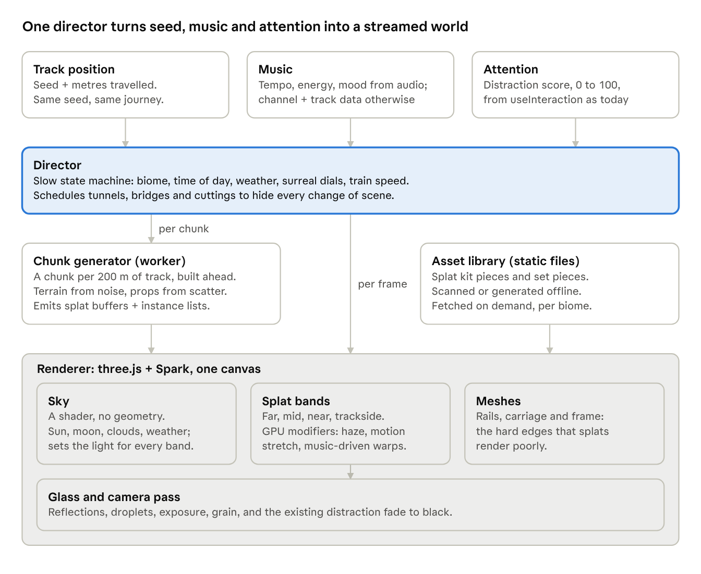

# Soma Rail: Procedural Train Window — Design Doc

Draft of 19 November 2026 · committed copy of the [living doc](https://claude.ai/artifact/UeqzGYDoiugh3gkaXbHHqP)

## Summary

Replace the looping YouTube video with a train-window view generated in the browser: layered Gaussian splats for the land, a shader for the sky and a glass-and-camera pass on top, all steered by a slow "director".

- **Splats can be generated procedurally, at two levels.** Code arranges photoreal pieces, and code also writes splats of its own. The first gives the photographic half of the look, the second the surreal half.
- **The side-window camera makes this tractable.** The world is used once, from one side, and the nearest layer is motion blur.
- **Music reactivity is feasible in the browser.** The blocker is cross-origin access to the SomaFM audio, not the models. v1 reacts to channel and track metadata; the rest depends on SomaFM's answer.
- **The distraction mechanic improves.** Train speed becomes continuous, so the world can brake to a halt and sharpen as it does.
- **Next step: a one-biome look spike.** Nothing else matters until that looks right.

One caveat on this draft: facts about Spark, WebGPU support and the in-browser audio models come from search results. This environment could not open those pages or reach SomaFM, so the spikes confirm them.

## Where we are today

Soma Rail is a static Vue 3 + Vite app on GitHub Pages that plays a SomaFM stream over a muted, full-screen YouTube embed of one train journey. Nothing is rendered by us, and nothing listens to the audio.

| Piece | How it works now | What it means for the redesign |
| --- | --- | --- |
| The view | `VideoPlayer.vue` wraps the YouTube IFrame API around one hard-coded video (`YOUTUBE_VIDEO_ID` in `src/config.js`), seeks to 8 s and loops | Swap in a canvas renderer behind the same props (`visible`, `distractionScore`). No ad-blocker or embed failures. |
| Distraction mechanic | `useInteraction` turns mouse movement and tab blur into a 0–100 score; `usePlaybackControl` maps it to video playback rate and audio volume | Train speed becomes a continuous parameter. YouTube snaps to a few fixed rates and cannot stop; a generated world can brake smoothly to a halt and pull away again. |
| Audio | A plain `<audio>` element on a SomaFM Icecast stream, no `crossorigin`, no Web Audio graph | The renderer cannot read samples from this stream as it stands. This is the main blocker for music reactivity (see that section). |
| Metadata | `channels.json` gives genre and description; `songs/<channel>.json` is polled every 45 s for artist and title | A signal we already have, with no audio access needed, for slow style changes. |
| Hosting | GitHub Pages from `soma-rail-app/dist`, custom domain, no backend | Assets must fit a static host or move to a CDN. Any proxy or server-side generation is a new piece of infrastructure. |
| Dependencies | `vue` only | The renderer is the first heavy dependency; load it after the Start click. |

## Visual target

The view should pass for footage at a glance and reveal itself as impossible on a second look. The rule that gets us there: the physics of the camera stays real, and the contents of the world do not have to be.

The camera is a side window: it slides sideways at train speed, looks out at right angles to the track, and never turns. That constraint does most of the work for us.

- **Parallax is the whole depth cue.** On-screen speed falls off as 1/distance, so a few depth bands moving at the right rates read as a deep world.
- **The world is used once, from one side.** Scenery is generated ahead, off-screen, and thrown away behind. Nothing is ever seen from the back.
- **The near field is a blur.** At 100 km/h an object 5 m from the glass crosses the window in about a quarter of a second, so the hardest layer to make detailed is the one nobody can inspect.
- **The glass is a layer too.** Reflections of the carriage, dirt, rain and the frame say "photograph" more than anything outside does.

| Band | Distance | What lives there | How it behaves on screen |
| --- | --- | --- | --- |
| Glass | 0 m | Frame, reflections, droplets, dirt | Fixed to the screen; shakes with the carriage |
| Trackside | 2–30 m | Masts, wires, fences, embankment, passing trains | Streaks; rhythm more than detail |
| Near | 30–300 m | Trees, houses, roads, platforms | Fast slide; the band where detail is actually read |
| Mid | 300 m–3 km | Fields, water, towns, forests | Slow slide; carries the sense of place |
| Far | 3 km and beyond | Mountains, skylines, anything impossible | Barely moves; where the surreal subjects sit |
| Sky | Infinite | Sun, moon, clouds, weather | Static apart from its own drift |

What must stay real, or the picture reads as a game:

- Motion blur and parallax that match the speed
- Haze: contrast and saturation fall with distance
- One sun, lighting every band consistently
- A camera: exposure that adapts, grain, a little lens softness

What is free to break, each on a dial from 0 to 1:

- **Scale**: a moon ten times too large, a mountain range that never ends
- **Topology**: land folded overhead, islands that float, the sea where the sky should be
- **Matter**: a forest that dissolves into the points it is made of, then reforms as a city
- **Time**: dusk to dawn in two minutes, seasons changing halfway across a field
- **Logic**: the same station passing three times, each time slightly wrong

## Rendering approaches compared

Gaussian splats are the right primary medium, used two ways at once, with a shader sky and a few meshes around them. No single technique covers both "photoreal" and "endless".

| Approach | Realism | Surreal and reactive | Endless | Cost in the browser | Role here |
| --- | --- | --- | --- | --- | --- |
| Splat kit: captured or AI-generated pieces, placed by code | High; inherits the source | Good; any piece can warp or dissolve on the GPU | Arrangement is endless, the set of pieces is finite | Assets streamed per biome, tens of MB each (estimate) | Core of the near and mid bands |
| Splats written by code from noise fields | Painterly, not photographic | Best; every parameter is ours | Fully | No download; worker time per chunk | Ground, water, far band, all "matter" effects |
| Raymarched shader world | High for sky, haze, water, distant terrain; poor for trees and buildings | Best | Fully | No download; heavy per pixel at high resolution | Sky and atmosphere |
| Mesh scene with instanced props | Reads as a game without a lot of art | Moderate | Fully | Cheapest and most predictable | Rails, carriage, window frame |
| Diffusion model running in the browser | High per frame | High | Frames do not hold parallax | GB-scale download, seconds per frame (estimate) | Not in v1 |
| Worlds generated offline by a world model, shipped as splats | High, and surreal on request | Same as the kit | Bounded scenes, not strips | Paid per generation at build time; static files at run time | Where kit pieces and set pieces come from |

### Can splats be procedurally generated?

Yes, at two levels, and the two give different looks.

A splat is only a primitive: a position, three scales, a rotation, a colour and an opacity. Nothing requires it to come from a capture. What makes a splat scene photographic is where those numbers came from.

- **Procedural arrangement.** Pieces whose splats came from photos or from a generative model keep their realism when code places, scales and tints them. This is how the view gets its photoreal half.
- **Procedural matter.** Splats emitted by our own functions (scatter them on a noise terrain, colour them from a palette) look painterly, soft-edged and slightly unstable. That look is the surreal half, and it costs no download.

Spark, the three.js splat renderer from World Labs, appears to support both: a `constructSplats` callback with `pushSplat` for building splats in code, and "dyno" modifiers that rewrite existing splats on the GPU each frame. That is from its docs as surfaced by search; the first spike confirms it.

### Why splats suit this camera in particular

The three things that must stay real are nearly free on Gaussians.

- **Motion blur.** For a camera that only translates, blur is the scene smeared along the track by speed times shutter time, at every depth. Stretching each splat along the track axis by that length gives correct, depth-dependent blur with no post-process. When distraction brakes the train, the blur shrinks and the world sharpens to a stop.
- **Haze.** Mix each splat's colour toward the sky colour by its distance.
- **Dissolve.** A splat scene can come apart into its points and reassemble as something else. No other medium does that natively, and it is the obvious thing for music to drive.

### On "inside out"

I read this as a scene built to be seen from within rather than orbited. The side window is the extreme case: every object is seen from one side, across a narrow range of angles. That lets us go further than inside-out capture and use one-sided pieces, such as an image plus a depth map turned into a sheet of splats. Flagged under open questions in case you meant something else.

## Recommended architecture

A slow-moving director decides what the journey is; a worker builds the world one chunk of track at a time; the renderer draws it as layered splats behind a pane of glass.

Read top to bottom: the director is the only thing the inputs touch, and it talks to the renderer every frame but to the generator only when a new chunk is due.

The decisions that shape everything else:

- **Splats are the common currency.** Kit pieces, code-made terrain and offline-generated set pieces all arrive as splats, so one set of GPU modifiers gives them the same haze, blur and warps.
- **Chunks are a pure function of seed and index.** No world state is stored. A journey can be resumed, shared as a seed, and regenerated identically.
- **Scene changes happen out of sight.** A tunnel, a cutting, a passing freight train or a bank of fog covers each swap of biome or asset set. These are the natural cuts of a train journey.
- **Speed is the one fast coupling.** The world advances by speed times frame time, and the blur stretch uses the same number. Distraction lowers speed; nothing else needs to know.
- **The camera stays at the origin.** The world scrolls past it and chunks are rebased, which avoids float precision trouble on a journey with no end.
- **It slots in where the video was.** A `TrainWindow.vue` takes the same props as `VideoPlayer.vue`, and the renderer is imported after the Start click.

## Music reactivity

The models are not the obstacle; reaching the audio is. Analysis models that fit this job run in the browser, but the page cannot read samples from the SomaFM stream as it is served today. So v1 reacts to metadata, and full reactivity waits on one question to SomaFM.

### The blocker

Web Audio outputs silence for a media element whose source is cross-origin and was not fetched with CORS. The repo's `CROSSORIGIN_FIX.md` records that adding `crossorigin="anonymous"` made SomaFM answer 403, which is why the attribute was removed.

That finding is not settled. `BRAVE_GPC_ISSUE.md` blames a different header for the same symptom, and I could not test from this environment because the SomaFM hosts are blocked here. One `curl` of a stream URL with an `Origin` header, checking for `Access-Control-Allow-Origin` in the reply, settles it.

| Route to a signal | What it gives | Cost and risk | Verdict |
| --- | --- | --- | --- |
| Channel and track metadata, which we already fetch | Genre, description, artist, title, track-change events | None. No beat, no energy. | v1 |
| SomaFM allows CORS on streams | Full samples | One email; their decision | Ask now |
| Our own relay that adds the CORS header | Full samples | New infrastructure; about 58 MB per listener-hour at 128 kbps passes through us; hides listeners from SomaFM's own counts | Only with their blessing |
| Tab-audio capture | Full samples | A permission prompt every session; patchy browser support | Opt-in at most |

### What runs in the browser once we have samples

| Tier | Refresh | Tools | Output |
| --- | --- | --- | --- |
| Signal | Every frame | `AnalyserNode` or an AudioWorklet | Loudness, brightness, onsets, energy per band |
| Rhythm | Every few seconds | Essentia.js (WebAssembly) or our own onset tracker | Tempo and beat phase |
| Mood and style | Every 10–30 s, in a worker | Essentia.js mood and genre classifiers on TensorFlow.js; CLAP through transformers.js | Mood scores; how closely the music matches any text we write |

CLAP is the one to try first. It places audio and text in the same space, so the last ten seconds of music can be scored against our own biome descriptions ("salt flat at dusk", "neon city in rain") and the best match steers the director. No hand-built genre table. Its download size and speed in a browser are unverified and belong to a spike.

### Three clocks

| Clock | Signal | What it drives |
| --- | --- | --- |
| Beat, under a second | Onsets, beat phase | Trackside rhythm: mast spacing, lamp flicker, a slight breath in splat scale |
| Phrase, 5–30 s | Energy, brightness | Density of the near band, weather, haze, the surreal dials |
| Track, minutes | Mood and style, track change | Biome, palette, time of day; a track change queues a tunnel |

The mapping to build first is masts on the beat: spacing = speed × seconds per bar. At 100 km/h and 120 BPM that is 56 m, close to real overhead-line mast spacing, so the effect is felt without looking staged.

This is a focus tool, and the distraction mechanic already punishes fidgeting. Reactivity should be felt more than watched: no strobing, and the slow clocks carry most of the change.

### Metadata-only v1

- Each channel gets a base profile (biomes, palette, surreal level), matched from its description at build time and shipped as JSON.
- A track change from the existing 45 s poll queues a scene transition.
- A hash of artist and title seeds the variation, so the same track always brings the same scenery.

## Performance and compatibility budget

Build on WebGL2 first and treat WebGPU as an upgrade. Spark's mainline renderer targets WebGL2, which runs everywhere the current app does; WebGPU is on by default in Chrome, Edge and Safari 26, but Firefox coverage still depends on platform.

| Budget | Target | Basis |
| --- | --- | --- |
| Frame rate | 60 fps desktop, 30 fps phones | A smooth slide matters more than detail; the eye tracks the parallax |
| Splats in view | About 1.5 million desktop, 400 thousand phones | My estimate from typical splat viewers; the first spike measures it |
| Chunk build time | Under 50 ms in the worker | A 200 m chunk is needed every 7 s at 100 km/h, so this leaves wide margin |
| First view | Under 5 s on broadband | Open on a code-made biome that needs no assets; stream kit pieces behind it |
| Assets per biome | 30 MB or less | Keeps a session inside a sensible data budget; decides whether Pages is enough |
| Render resolution | Scale down to hold frame rate | Blur and haze hide a lower internal resolution well |

What needs watching:

- **Sorting.** Splats are blended back to front, and a sideways-moving camera changes the order constantly. This is the cost most likely to set the splat budget.
- **Hosting.** GitHub Pages caps site size and expects modest bandwidth. A kit of several biomes will probably outgrow it and move to object storage with a CDN.
- **WebGPU extras.** Three.js has merged a native WebGPU splat renderer and World Labs has an experimental WebGPU Spark. Both are new; neither should be on the critical path.
- **Fallback.** If the canvas cannot start, keep the current video as the fallback view, so no listener is left with a black screen.
- **Motion sensitivity.** Honour `prefers-reduced-motion` with a slower train and no beat-driven effects.

## Prototype plan

The first risk is aesthetic, not technical: nobody knows yet whether a code-arranged splat world looks good sliding past a window. Spike 1 answers that before anything else is built.

1. **The look.** One biome in three.js and Spark: code-made ground, five to ten free splat pieces scattered along it, a shader sky, the motion-stretch and haze modifiers, speed bound to the distraction score.
   - Pass: a 20-second recording that someone takes for footage at first glance.
   - Also yields the real splat budget on a laptop and a phone.
2. **The audio question.** Run the `curl` test and write to SomaFM. An hour of work, done alongside spike 1; the answer decides what spike 4 builds.
3. **Endless without seams.** The chunk generator in a worker, deterministic by seed, with two biomes and a tunnel between them.
   - Pass: memory stays flat and no visible pop over a 30-minute run.
4. **Reactivity.** Channel profiles and track-change transitions from metadata. If samples are available: masts on the beat, then CLAP scoring against biome descriptions.
5. **Asset pipeline.** Produce a handful of pieces two ways, from a world model and from an image plus depth map, then compress them and judge them from the window. Settles asset size, cost and hosting.
6. **The glass.** Frame, reflections, droplets, exposure and grain. Last because the technique is well known, though it is the largest single gain in polish.

Ship behind a `?view=generated` flag, with the video as the default until the generated view is clearly better.

## Open questions

- [ ] Does SomaFM send CORS headers on any stream, and if not, would they enable it or permit a relay? This gates audio-driven reactivity.
- [ ] What did "inside out" mean to you? I took it as a scene built to be seen from within.
- [ ] Are AI-generated assets acceptable, with a paid generation step at build time, or should the kit be captured and openly licensed only?
- [ ] Is a backend allowed at all (an asset CDN, possibly a relay), or must the app stay purely static?
- [ ] Are phones a first-class target or best effort?
- [ ] How surreal is the default? Two or three reference films or images would pin this down faster than any description.
- [ ] Should the carriage be visible (window frame, interior reflections), or is the view full-bleed as it is now?
- [ ] Should a journey be shareable as a seed in the URL?
- [x] Should a copy of this doc live in the repo under `docs/`? Yes: this file.

## Sources

Found by search and not opened; treat each as a lead to verify.

- Spark docs: [procedural splats](https://sparkjs.dev/docs/procedural-splats/), [dyno overview](https://sparkjs.dev/docs/dyno-overview/), [new in 2.0](https://sparkjs.dev/docs/new-features-2.0/)
- [Three.js merges a native splat renderer for WebGPU in r186](https://radiancefields.com/three.js-merges-a-native-gaussian-splat-renderer-for-webgpu-in-r186)
- [Spark Radix, experimental WebGPU splat rendering](https://radiancefields.com/spark-radix-brings-webgpu-splat-rendering-to-threejs)
- [WebGPU is now supported in major browsers](https://web.dev/blog/webgpu-supported-major-browsers)
- [CLAP for transformers.js](https://huggingface.co/Xenova/clap-htsat-unfused)
- [Essentia.js](https://mtg.github.io/essentia.js/)
- [World Labs API FAQ](https://docs.worldlabs.ai/api/faq)
- [Chromium: silence for a cross-origin media element source](https://codereview.chromium.org/520433002/)
